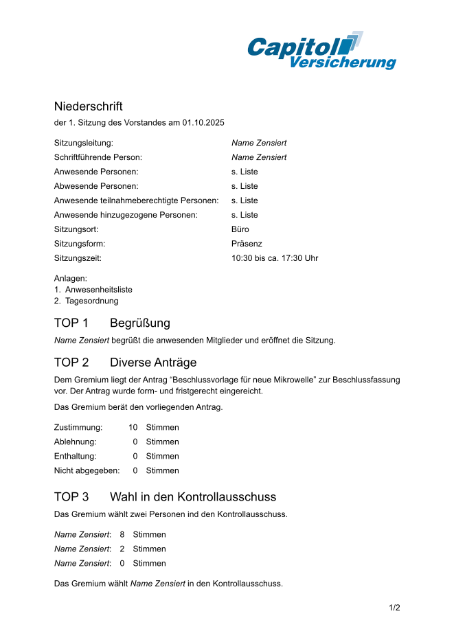

# fast-minutes

A Typst template for writing minutes (Niederschriften) of your favorite Gremiensitzungen — fast, with VS Code snippets for all the standard phrases.



## Getting started

Requires [Typst](https://github.com/typst/typst) (tested with 0.14) and Bash.

```sh
git clone https://github.com/nilsfast/fast-minutes.git
cd fast-minutes
./install-local.sh                                 # installs the package as @local/fast-minutes (only tested on linux)
typst init @local/fast-minutes:0.0.1 my-minutes    # new project from the example
cd my-minutes
typst watch main.typ
```

For the [snippets](#snippets) (German only), copy `.vscode/fast-minutes.code-snippets` into `my-minutes/.vscode/`. Run `./install-local.sh` again after you `git pull`.

## Usage

```typ
#import "@local/fast-minutes:0.0.1": *

#show: minutes.with(
  committee: "Vorstand",
  session: "1. Sitzung des Vorstandes",
  date: datetime(year: 2025, month: 10, day: 1),
  redact: false,                // optional
  anonymize: false,             // optional
  logo: image("logo.png"),
  agenda: toml("agenda.toml"),  // optional
  names: toml("names.toml"),    // optional
)

#agendaitem("1 Begrüßung")
#n[Bernd Stromberg] begrüßt die anwesenden Mitglieder und eröffnet die Sitzung.
```

See [template/src/main.typ](template/src/main.typ) for a complete example.

### Redaction and anonymisation

One source file can produce several versions of the minutes. The two settings are independent:

| Setting           | Effect                                                    |
| ----------------- | --------------------------------------------------------- |
| `redact: true`    | Content inside `#redact[…]` is blacked out                |
| `anonymize: true` | Every `#n[…]` name is replaced with _Name Zensiert_       |

### Agenda and names

`agenda.toml` maps numbers to titles. A table is a TOP with sub-items, whose keys are appended to its number:

```toml
1 = "Begrüßung"
2 = "Berichte"

[3]
title = "Wahlen"
a = "Wahl in den Kontrollausschuss"
b = "Wahl in den Vorstand"
```

Tables can be nested further (`[3.b]` gives `3b…`). A plain list also works, via `agenda: read("agenda.txt")` with one item per line, number first (`3a Wahl in den Kontrollausschuss`).

`#top("Wahl")` then inserts `TOP 3a Wahl in den Kontrollausschuss`. An unknown item is a compile error.

`names.toml` maps abbreviations to full names, so `#n[bs]` prints _Bernd Stromberg_. Anything not in the file is printed as written.

```toml
bs = "Bernd Stromberg"
```

### Checking contributions

Every `#n[…]` is recorded, so each person can check what the minutes say about them.

```sh
# who is mentioned on which page
typst query main.typ "<n>" --field value | jq -c 'group_by(.name)[] | {name: .[0].name, pages: map(.page) | unique}'

# one PDF per person: their mentions highlighted, plus a clickable list of their TOPs at the top
for p in $(typst query main.typ "<n>" --field value | jq -r '.[].name' | sort -u); do
  typst compile --input check=$p main.typ check-$p.pdf
done
```

### Functions

| Function                                               | Purpose                                                                                          |
| ------------------------------------------------------ | ------------------------------------------------------------------------------------------------ |
| `minutes.with(body, session, date, redact, anonymize, logo, agenda, names)` | Document setup: page layout, logo header, title "Niederschrift der … am …"                       |
| `#qtable(..cells)`                                     | Borderless two-column table, e.g. for the session data                                           |
| `#agendaitem("3a Titel")`                              | Agenda item heading: the first word is the number, the rest is the title                         |
| `#inhalt()`                                            | Table of contents of all TOPs with page numbers; `title:` changes the heading (default _Inhalt_) |
| `#top("Wahl")`, `#top(3)`                              | Agenda item from the agenda file, found by number or by part of the title                           |
| `#part[Titel]`                                         | Centered bold heading, e.g. for "Nichtöffentlicher Teil"                                         |
| `#n[Name]`, `#n[bs]`                                   | Marks a name, which is anonymised with `anonymize: true`. Abbreviations from `names.toml` are expanded |
| `#redact[…]`                                           | Marks a non-public passage, which is blacked out with `redact: true`                             |
| `#votes[Ja/Nein/Enthaltung]`                           | Voting result; an optional fourth value is _Nicht abgegeben_                                     |
| `#elect("Name", 8, "Name", 2)`                         | Election result table (names go through `n`)                                                     |

## Snippets

[.vscode/fast-minutes.code-snippets](.vscode/fast-minutes.code-snippets) contains VS Code snippets for all the standard phrases. They work automatically when you open this folder; to use them in another project, copy the file into that project's `.vscode/` folder.

Type the prefix and press Tab, then press Tab to jump between fields. Fields that offer a choice (e.g. `Präsenz | Online | Hybrid`) show a dropdown, and times default to the current time. `nn` and `red` wrap the currently selected text.

Prefixes are grouped by their first letter (`s…` Sitzung, `a…` Antrag, `g…` GO, `w…` Wahl, `be…` Bericht).

#### Sitzung

| Prefix      | Snippet              | Inserts                                                                      |
| ----------- | -------------------- | ---------------------------------------------------------------------------- |
| `smin`      | Dokumentkopf         | `#show: minutes.with(…)` with Gremium, session, date, redact, anonymize, logo      |
| `si`        | Sitzungsdaten        | `#qtable` with Sitzungsleitung, Schriftführung, attendees, place, form, time |
| `anl`       | Anlagen              | List of attachments                                                          |
| `sbg`       | Begrüßung            | Sitzungsleitung opens the session                                            |
| `bf`, `sbf` | Beschlussfähigkeit   | Invitation date, members, present, quorum (not) established                  |
| `sto`       | Tagesordnung         | Agenda adopted, with votes                                                   |
| `ssf`       | Schriftführung       | Sitzungsleitung appoints the Schriftführung                                  |
| `spr`       | Protokoll genehmigen | Vote on and approval of the previous minutes                                 |
| `sga`       | Gäste                | Guests admitted, with votes                                                  |
| `sst`       | Stimmübertragung     | … überträgt die Stimme auf …                                                 |
| `sbe`       | Person betritt       | Person joins at … Uhr                                                        |
| `sve`       | Person verlässt      | Person leaves at … Uhr                                                       |
| `san`       | Anwesenheit          | "Es sind nun … stimmberechtigte Mitglieder anwesend."                        |
| `sun`       | Unterbrechung        | Session paused from … to … Uhr                                               |
| `sen`       | Schließung           | Sitzungsleitung closes the session at … Uhr                                  |

#### Struktur

| Prefix | Snippet                | Inserts                                               |
| ------ | ---------------------- | ----------------------------------------------------- |
| `top`  | TOP                    | `#agendaitem("1 Titel")`                              |
| `tp`   | TOP aus Tagesordnung   | `#top("…")` from the agenda file                         |
| `tar`  | Aufruf                 | TOP called at … Uhr                                   |
| `tew`  | Einleitung             | Sitzungsleitung says a few introductory words         |
| `tvs`  | Verschoben             | _Tagesordnungspunkt verschoben vom Vortag_            |
| `tei`  | Teil-Überschrift       | `#part[…]`                                            |
| `nft`  | Nichtöffentlicher Teil | Start of the non-public part, wrapped in `#redact[…]` |
| `red`  | Schwärzen              | `#redact[…]` around the selection                     |
| `nn`   | Name                   | `#n[…]` around the selection                          |
| `kth`  | Keine Themen           | "Keine Themen."                                       |

#### Bericht

| Prefix | Snippet      | Inserts                   |
| ------ | ------------ | ------------------------- |
| `bea`  | Kurz         | "… erstattet Bericht."    |
| `beb`  | Sachstand    | … reports on the status of … |
| `mb`   | Meinungsbild | Straw poll, with votes    |

#### Antrag

| Prefix       | Snippet         | Inserts                                            |
| ------------ | --------------- | -------------------------------------------------- |
| `aku`, `ant` | Kurz            | Motion submitted by …, form- und fristgerecht      |
| `ala`        | Lang            | Same, with the motion's title                      |
| `awo`        | Wort            | Applicant is given the floor                       |
| `abr`        | Beratung        | Gremium discusses the motion                       |
| `aen`        | Änderung        | Amendment to …, with its text                      |
| `aen`        | Änderungsantrag | Amendment, adopted or not adopted by the applicant |
| `agh`        | Geheime Abstimmung | Request for a secret ballot, adopted immediately |
| `abs`        | Abstimmung      | Vote on the motion or amendment, with votes        |
| `vo`         | Stimmen         | `#votes[0/0/0]`                                    |
| `ang`        | Angenommen      | Motion adopted                                     |
| `abg`        | Abgelehnt       | Motion rejected                                    |
| `azu`        | Zurückgezogen   | Motion withdrawn by …                              |

#### GO (Geschäftsordnung)

| Prefix | Snippet            | Inserts                                                   |
| ------ | ------------------ | --------------------------------------------------------- |
| `go`   | GO-Antrag          | … stellt Antrag auf (Schluss der Redeliste, Vertagung, …) |
| `gge`  | Gegenrede          | Gegenrede, then a vote                                    |
| `gan`  | Angenommen         | Adopted without Gegenrede                                 |

#### Wahl

| Prefix | Snippet  | Inserts                                 |
| ------ | -------- | --------------------------------------- |
| `wa`   | Einleitung | "Das Gremium wählt …"                 |
| `wka`  | Kandidaturen | List of candidates                   |
| `wvo`  | Vorstellung  | Candidates introduce themselves and answer questions |
| `wga`  | Wahlgang | Ballot round with `#elect(…)`           |
| `wgj`  | Wahlgang Ja/Nein | Ballot round with Ja/Nein/Enthaltung per candidate |
| `wbl`  | Blockwahl | Several people elected in one vote, with votes |
| `wer`  | Ergebnis | Election result                         |
| `wan`  | Annahme  | Person accepts or declines the election |
| `wgn`  | Annahme (mehrere) | "Die Gewählten nehmen die Wahl an." |
| `wab`  | Abwesend gewählt | Elected people are absent and will be contacted |

### Cheat sheet

[docs/cheatsheet.typ](docs/cheatsheet.typ) builds a printable overview of all snippets directly from the snippets file, so it is always up to date:

```sh
typst compile --root . docs/cheatsheet.typ
```

## Credits

Example logo: https://www.reddit.com/user/fiskimata/
